# Arch Studio (가칭)

1~5인 건축사사무소와 전원주택 시공사를 위한 **AI 설계실무 도구**입니다.
대지를 불러오면 법규상 지을 수 있는 볼륨(법규 엔벨로프)이 3D로 생깁니다. 매스를 움직이면 건폐율·용적률·정북 일조사선·주차·이격을 근거 조항과 함께 실시간으로 판정합니다. 배치도·면적 산정도·일조사선 단면은 DXF·SVG·PDF로 자동 작도합니다.

- **제공 방식**: 웹(SaaS, `app.` 웹 스튜디오)과 설치형(Windows, Tauri)의 기능이 같습니다. 웹에서 바로 시작하거나, 랜딩에서 설치형을 내려받을 수 있습니다. 설치형은 여기에 오프라인 작업과 로컬 파일을 더합니다. → [ADR-001](docs/file/03-설계/ADR-001_DELIVERY_AND_LICENSING.md)
- **라이선스**: 웹과 설치형 모두 영구 / 기간제 / 구독 3종이며, 좌석(사용자) 단위로 팝니다.
  - 영구 라이선스로 웹을 쓸 수 있는 기간은 업데이트 기간 동안입니다. 이 점을 구매 전에 고지합니다.
  - 체험 크레딧은 휴대폰 본인인증을 한 뒤에 지급합니다.
  - 새 상품(기간제 등)의 가격은 아직 정하지 않았습니다.
- **크레딧**: 판정·도면·매스 제안은 0크레딧입니다. AI 렌더·클라우드 법규 검토·제안서 PDF·법규 채팅에는 크레딧이 듭니다.

## 진행 현황 (2026-10-28 기준)

| 영역 | 진행률 | 상태 |
|---|---|---|
| 환경·멀티에이전트 구성 | 약 97% | NOMAD Agent OS **v3.0**을 적용해 팀원 12명(Codex 2명 포함)·SDLC 9단계·훅·영역 규칙이 동작합니다. 점검 결과 ❌는 0개입니다 |
| 기획 | 약 92% | 재정비를 마쳤고, 하이브리드 구조(ADR-001)도 확정해 반영했습니다. 남은 일은 결정 항목과 문서 길이 정리입니다 |
| 디자인 | 약 40% | 토큰과 DESIGN.md 초안을 만들었고 다크 랜딩을 확정했습니다. `/download`·체험 가입·좌석 관리 화면 명세도 썼습니다. 비주얼 판정(AR-06-011)과 화면 구현은 남았습니다 |
| 다이어그램 | 약 70% | 구조도·도면 생성 흐름·ERD·팀 다이어그램 3종을 만들었습니다(아래). 새 테이블을 반영한 ERD 갱신과 시퀀스도 추가가 남았습니다 |
| 개발 | 0% | 작업 84개(기존 71 + 하이브리드 13)가 모두 대기 중입니다. W0의 첫 작업은 AR-06-019 도면 스파이크와 AR-06-071a 웹·설치형 공유 스파이크입니다 |

진행률은 결과물이 있는지와 확정이 남았는지를 보고 추정한 값입니다. 측정한 수치가 아닙니다.

### 완료한 일
- [x] platform-docs에서 Arch Studio 자료를 이관했습니다. 근거 문서 26개, 위키, Supabase 마이그레이션·시드·RLS 테스트, 원본 기획서·개발서(`docs/source/`)입니다.
- [x] 멀티에이전트 구성을 마쳤습니다. `AGENTS.md`를 채웠고, 영역 규칙 6개(web·desktop·engine·api·db·docs)를 두었습니다. 상시 로드 규칙은 3191에서 2377 토큰으로 줄였습니다.
- [x] 디자인 시안 원본을 보관했습니다. 랜딩은 `design/reference/landing/`, 대시보드 셸(화면 21개)은 `design/reference/dashboard/`에 있습니다.
- [x] 디자인 토큰을 만들었습니다. `packages/ui/src/tokens.css`(Tailwind CSS v4, 앱 라이트 / 랜딩 다크)와 `DESIGN.md`입니다.
- [x] 기획을 재정비했습니다.
  - 린 검증 문서를 새로 만들었습니다: [00_LEAN](docs/file/02-요구사항/00_LEAN.md)
  - 경쟁사 15곳을 벤치마킹했습니다: [08_BENCHMARK](docs/file/02-요구사항/08_BENCHMARK.md)
  - 보안 관리 계획을 세웠습니다. 보안 레벨 L2(제안)와 위협 분석 12건이 들어 있습니다: [09_SECURITY_PLAN](docs/file/03-설계/09_SECURITY_PLAN.md)
  - PRD를 정비했습니다. 착수 차단 결정 표, 기능 ID 색인, 계측 이벤트, 보안 12장, 경쟁 대응 13장을 추가했습니다.
  - 화면·API·데이터 문서에 기능 ID 추적 열을 추가했습니다. 줄 번호 인용 155곳은 장 번호 인용으로 바꿨습니다.
- [x] 하이브리드 제공 구조를 확정했습니다.
  - Fusion·Rhino·Onshape·SketchUp·AutoCAD Web·Figma를 벤치마킹했습니다: [10_DELIVERY_BENCHMARK](docs/file/03-설계/10_DELIVERY_BENCHMARK.md)
  - [ADR-001](docs/file/03-설계/ADR-001_DELIVERY_AND_LICENSING.md)을 작성하고, challenger 검토에서 나온 🔴 2건을 해소했습니다.
  - 확정한 내용을 PRD·구조·화면·API·데이터·보안 문서에 반영했습니다. 웹 스튜디오 `app.`, 클라우드 단일 파일 저장, 좌석·기간제·본인인증 데이터 설계, 규칙 팩 서버 분리가 들어 있습니다.
  - 랜딩에 `/download` 페이지(OS 감지·서명·릴리스 노트)와 "웹에서 바로 시작" 버튼을 넣었습니다.
- [x] 작업 표를 갱신했습니다. `tasks/README.md`에 84개 작업과 팀원 담당·위험도·웨이브를 정리했습니다.
- [x] NOMAD v3.0 규칙을 적용했습니다(2026-10-28). Codex 팀원(codex-designer·codex-reviewer)과 위험도별 검증 규칙을 작업 표에 넣었고, 디자인 작업 9개는 공동 디자인으로 바꿨습니다. `tasks/NOW.md`에는 이관용 필드(SDLC 단계·담당 모델·수정 파일·테스트 상태·남은 작업)를 추가했습니다.

### 진행 중 / 다음
- [ ] 결정 받을 항목
  - 착수 차단 결정(PRD 8.0절)
  - 보안 결정 S-1~S-14
  - 기간제 세부 규칙과 새 상품 가격
  - 웹 스튜디오 인증 방식(Bearer 또는 쿠키+CSRF)
  - DB 수정 규칙 예외
- [ ] 새 마이그레이션을 작성합니다(좌석·기간제·본인인증·`cloud_projects` 키 변경).
- [ ] ERD 갱신: 새 마이그레이션을 작성한 뒤 `sql2erd`로 다시 생성합니다.
- [ ] 개발 착수: W0 스파이크 2건부터 시작합니다(`/next`).

## 다이어그램

Mermaid 원본(`.mmd`)과 렌더링한 그림(`.svg`)을 `docs/diagrams/`에 둡니다. 6개 모두 `mmd-check` 문법 검사를 통과했습니다.

### 제품 구조
| 다이어그램 | 내용 |
|---|---|
| [구성도](docs/diagrams/architecture.svg) ([원본](docs/diagrams/architecture.mmd)) | 랜딩·웹 스튜디오·설치형 셸 → 공유 엔진 패키지 → 플랫폼 어댑터 5종 → 서버·외부 서비스. 신뢰 경계도 표시합니다 |
| [도면 생성 흐름](docs/diagrams/drawing-flow.svg) ([원본](docs/diagrams/drawing-flow.mmd)) | 대지 → 법규 엔벨로프 → 매스·실시간 판정 → 도면 엔진 → 내보내기. "LLM은 좌표를 만들지 않는다"는 경계도 표시합니다 |
| [ERD](docs/diagrams/erd.svg) ([원본](docs/diagrams/erd.mmd)) | 현재 마이그레이션 기준 테이블 49개를 `sql2erd`로 자동 생성했습니다. 좌석·기간제·본인인증 테이블은 새 마이그레이션 작성 후 갱신합니다 |

### 팀(멀티에이전트) 업무
| 다이어그램 | 내용 |
|---|---|
| [팀 조직도](docs/diagrams/team-org.svg) ([원본](docs/diagrams/team-org.mmd)) | 팀장(Opus)과 팀원 12명(Claude 10 + Codex 2)의 모델·역할, 작업 표 84개의 담당 분포 |
| [작업 흐름](docs/diagrams/team-workflow.svg) ([원본](docs/diagrams/team-workflow.mmd)) | SDLC 9단계와 작업 하나의 흐름: 위험도 판정 → challenger(고위험) → builder → codex-reviewer(+reviewer) → tester → advisor(2회 실패 시) → 팀장 커밋. Codex를 못 쓸 때의 대체 경로와 모델 한도 대응(`handoff`)도 그렸습니다 |
| [2026-10-28 세션](docs/diagrams/team-session-2026-10-28.svg) ([원본](docs/diagrams/team-session-2026-10-28.mmd)) | 오늘 팀원들이 실제로 한 일의 순서이고, 병렬 위임은 par 블록으로 표시했습니다. 순서는 위임 기록 기준이며 호출 시각으로 확인한 것은 아닙니다 |

## 폴더 구조

| 경로 | 내용 |
|---|---|
| `AGENTS.md` · `CLAUDE.md` | AI 도구 공통 규칙(정본) · Claude Code 전용 설정 |
| `docs/file/` | 기획·설계 정본입니다(PRD·구조·화면·API·데이터·보안·ADR·작업 계획) |
| `docs/source/` | platform-docs 원본 사본입니다. 읽기만 합니다 |
| `docs/wiki/` · `docs/reference/` | LLM 위키 · 이관 분석·리뷰 |
| `docs/STACK.md` | 스택·명령·문서 지도 |
| `docs/diagrams/` | 구조도·흐름도·ERD·팀 다이어그램(Mermaid + SVG) |
| `design/` | 확정 시안 원본과 토큰 미리보기 |
| `packages/ui/src/tokens.css` · `DESIGN.md` | 디자인 토큰(정답) · 디자인 설명 |
| `supabase/` | 마이그레이션·시드·RLS 스모크 테스트 |
| `infra/dify/` | 법규 채팅(Dify) 메모 |
| `tasks/` | 작업 표(`README.md`) · 현재 상태(`NOW.md`) |

## 스택

Tauri 2 + Rust(설치형) · Next.js 16 + React 19 + Tailwind CSS v4(웹·웹 스튜디오) · 순수 TS 엔진(지오메트리·판정·도면, 웹과 설치형이 공유) · Supabase(Postgres·RLS·Auth) · FastAPI + LangGraph(AI). 상세는 [docs/STACK.md](docs/STACK.md)를 보세요.

## 작업 방식

[NOMAD Agent OS](https://github.com/DevOps0906/nomad-agent-os) v3.0의 팀 구성으로 진행합니다. 팀장(Opus 5.5)은 최종 판단과 승인을 맡고, 나머지 일은 팀원에게 나눕니다.

| 팀원 | 모델 | 맡는 일 |
|---|---|---|
| planner ⇄ codex-designer | Sonnet ⇄ Codex | 공동 기획(PRD·명세·ADR)과 공동 UX·IA·와이어. 한쪽이 초안을 쓰면 상대는 변경분만 교차 검토합니다 |
| designer ⇄ codex-designer | Sonnet ⇄ Codex | 공동 UI(토큰·DESIGN.md·미리보기) |
| diagrammer | Haiku | 구조도·흐름도·ERD(Mermaid) |
| builder · tester | Sonnet | 구현 · 테스트 |
| codex-reviewer | Codex | 독립 품질 검증(code·design·a11y·security). Codex를 못 쓰면 reviewer(Sonnet)가 대신합니다 |
| challenger | Opus | 결제·인증·RLS 같은 고위험 작업을 착수 전에 공격적으로 검토합니다 |
| scout · intern | Haiku | 탐색 · 반복 변환 |
| advisor | Fable | 같은 문제로 2회 실패했을 때만 부릅니다 |

- **SDLC 9단계**: 01 검증 → 02 기획 → 03 UX → 04 UI → 05 기술 설계 → 06 구현 → 07 QA → 08 배포 → 09 개선. 단계가 끝날 때마다 `tasks/NOW.md`를 갱신합니다.
- **모델 한도 대응**: 모델 한도에 걸리면 `handoff sonnet`, `handoff codex`로 다른 모델이 이어서 작업하고, 복귀할 때는 `handoff claude`를 씁니다.
- Claude Code에서 `/next`를 입력하면 작업 표의 다음 작업 하나를 끝까지 진행합니다.
